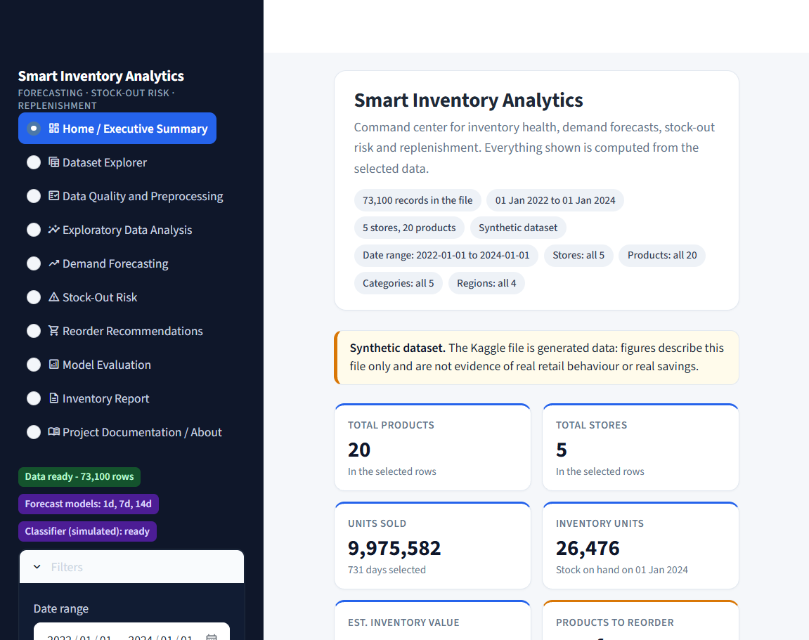
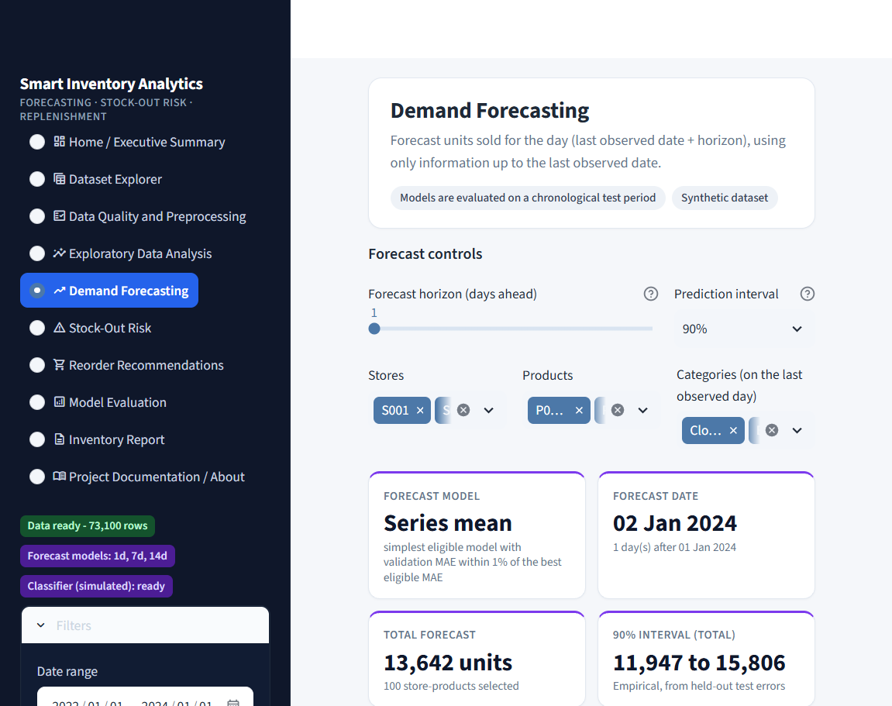
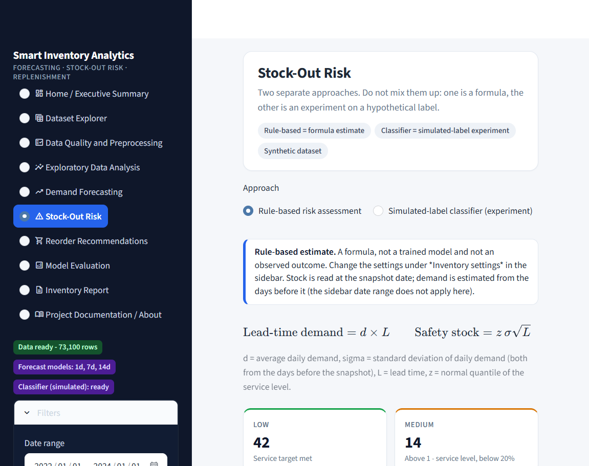
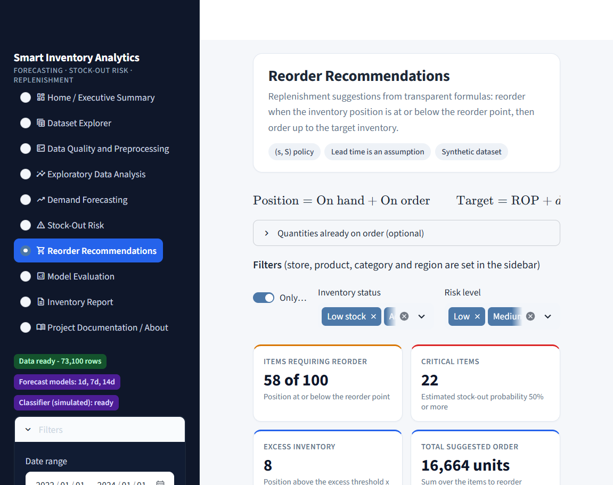
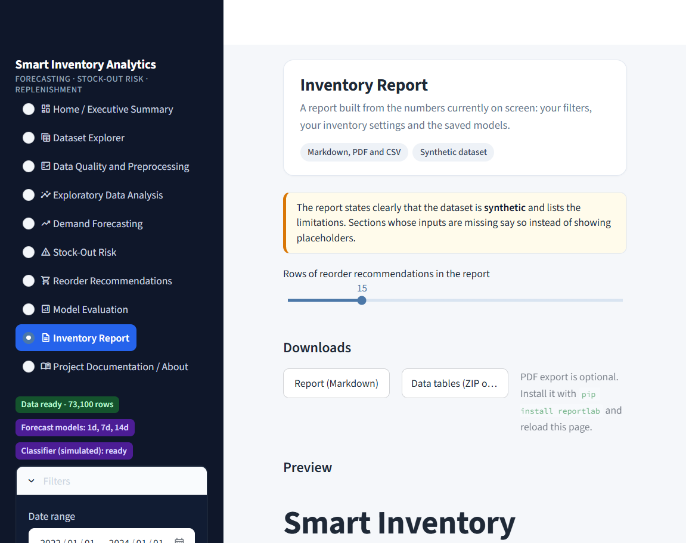

# 📦 Smart Inventory Analytics, Demand Forecasting & Stock-Out Prediction

An end-to-end **Machine Learning and Inventory Analytics System** built using Python and Streamlit to analyze retail inventory, forecast product demand, identify stock-out risks, and generate inventory replenishment recommendations.

This project demonstrates how data science and machine learning can support inventory management decisions through interactive analytics, forecasting models, risk assessment, and inventory policy simulation.


---

## 📊 Project Overview

Inventory management is an important challenge for retail businesses. Overstocking increases inventory holding costs, while insufficient stock can lead to stock-outs and lost sales.

The **Smart Inventory Analytics System** provides a data-driven approach to inventory management by combining:

- Exploratory Data Analysis (EDA)
- Data Quality Assessment
- Machine Learning-Based Demand Forecasting
- Stock-Out Risk Analysis
- Inventory Reorder Recommendations
- Inventory Policy Simulation
- Interactive Business Analytics Dashboard
- Automated Report Generation

The application transforms retail inventory data into meaningful insights that can help users understand demand patterns, identify inventory risks, and evaluate replenishment strategies.


---

## 📸 Dashboard Preview

### Executive Dashboard



### Demand Forecasting



### Stock-Out Risk Analysis



### Reorder Recommendations



### Inventory Report



---

## ✨ Key Features

### 🏠 Executive Dashboard

- Inventory overview and business KPIs
- Inventory health classification
- Critical and low-stock identification
- Excess inventory detection
- Inventory trend visualization
- Automatically generated analytical insights

### 📈 Demand Forecasting

- 1-day, 7-day, and 14-day demand forecasting
- Machine learning model using HistGradientBoosting
- Forecast evaluation using WAPE and other error metrics
- Series-mean baseline comparison
- Empirical prediction intervals based on held-out residuals
- Actual versus predicted demand visualization

### 🚨 Stock-Out Risk Prediction

- Rule-based stock-out risk assessment
- Machine learning-based stock-out classification
- Low, Medium, High, and Critical risk levels
- Stock-out risk analysis and visualization
- ROC, Precision-Recall, and calibration analysis using saved test predictions

### 📦 Reorder Recommendations

- Inventory replenishment recommendations
- Reorder point analysis
- Recommended order quantity
- Inventory policy simulation
- Fill rate analysis
- Stock-out-day frequency analysis
- Average inventory analysis

### 📊 Exploratory Data Analysis

- Interactive dataset exploration
- Data quality assessment
- Missing value analysis
- Statistical summaries
- Demand distribution analysis
- Inventory trend visualization
- Category and regional analysis

### 📄 Inventory Reports

- Inventory summary reports
- Markdown report generation
- CSV report exports
- ZIP-based CSV report downloads
- Optional PDF report generation

---

## 🖥️ Application Pages

The application contains the following pages:

| Page | Description |
|---|---|
| Home | Executive inventory dashboard |
| Dataset Explorer | Explore the retail dataset |
| Data Quality | Data validation and preprocessing |
| Exploratory Data Analysis | Statistical and visual analysis |
| Demand Forecasting | Forecast future product demand |
| Stock-Out Risk | Analyze stock-out probabilities and risk |
| Reorder Recommendations | Generate inventory replenishment recommendations |
| Model Evaluation | Evaluate forecasting and classification models |
| Inventory Report | Generate downloadable inventory reports |
| About | Project documentation and information |

---

## 🛠️ Technology Stack

| Technology | Purpose |
|---|---|
| Python | Core programming language |
| Streamlit | Interactive web dashboard |
| Pandas | Data manipulation and analysis |
| NumPy | Numerical computing |
| Scikit-learn | Machine learning and model evaluation |
| Matplotlib | Data visualization |
| Altair | Interactive charts |
| Joblib | Model serialization |
| Pytest | Automated testing |
| ReportLab | Optional PDF report generation |

---

## 🧠 Machine Learning Methodology

### Demand Forecasting

The forecasting module uses machine learning to estimate future product demand.

The system supports multiple forecast horizons:

- 1-day forecast
- 7-day forecast
- 14-day forecast

The forecasting pipeline includes data preprocessing, feature engineering, model training, evaluation, and prediction generation.

The HistGradientBoosting model is evaluated against a series-mean baseline.

Forecast evaluation includes metrics such as:

- Mean Absolute Error (MAE)
- Root Mean Squared Error (RMSE)
- Weighted Absolute Percentage Error (WAPE)

The application also provides empirical prediction intervals derived from held-out residuals.

### Stock-Out Prediction

The system includes two separate stock-out risk approaches:

1. **Rule-Based Risk Assessment:** Evaluates inventory conditions using predefined thresholds.
2. **Machine Learning Classification:** Uses a trained classifier to estimate stock-out risk based on its training data.

The classification evaluation includes ROC, Precision-Recall, and calibration analysis using saved test predictions.

### Inventory Optimization

The reorder optimizer evaluates inventory replenishment policies using a simulation.

The simulation provides metrics such as:

- Fill Rate
- Stock-Out-Day Frequency
- Average Inventory

The simulation uses documented assumptions and should be interpreted as an analytical demonstration rather than a real-world operational guarantee.

---

## 📁 Project Structure

```text
smart-inventory/
│
├── app.py
├── inspect_dataset.py
├── requirements.txt
├── README.md
├── pytest.ini
├── .gitignore
│
├── data/
│   ├── raw/
│   └── processed/
│
├── models/
│   ├── demand_model_h1.joblib
│   ├── demand_model_h7.joblib
│   ├── demand_model_h14.joblib
│   ├── stockout_classifier_simulated_L2.joblib
│   └── model_metadata.json
│
├── reports/
│
├── src/
│   ├── preprocess.py
│   ├── eda.py
│   ├── demand_forecasting.py
│   ├── stockout_prediction.py
│   ├── reorder_optimizer.py
│   ├── report_generator.py
│   ├── dashboard_metrics.py
│   ├── app_data.py
│   ├── app_charts.py
│   ├── ui_components.py
│   ├── ui_theme.py
│   ├── utils.py
│   │
│   └── views/
│       ├── home.py
│       ├── explorer.py
│       ├── quality.py
│       ├── eda_page.py
│       ├── forecast_page.py
│       ├── stockout_page.py
│       ├── reorder_page.py
│       ├── evaluation_page.py
│       ├── report_page.py
│       ├── about_page.py
│       └── sidebar.py
│
└── tests/
    ├── test_app.py
    ├── test_eda.py
    └── test_phase6.py
```

*The structure above summarizes the main project components. Some generated files and supporting modules may be omitted for readability.*

---

## ⚙️ Installation and Setup

### Prerequisites

- Python 3.12 recommended
- Git
- Visual Studio Code (recommended)
- Windows 10 or Windows 11

### 1. Clone the Repository

```powershell
git clone https://github.com/Sumit-Rajput09/smart-inventory.git
cd smart-inventory
```

### 2. Create a Virtual Environment

```powershell
python -m venv .venv
```

### 3. Activate the Environment

```powershell
.\.venv\Scripts\Activate.ps1
```

If PowerShell blocks script execution, run:

```powershell
Set-ExecutionPolicy -Scope Process -ExecutionPolicy Bypass
.\.venv\Scripts\Activate.ps1
```

### 4. Install Dependencies

```powershell
python -m pip install --upgrade pip
pip install -r requirements.txt
```

For optional PDF report generation:

```powershell
pip install reportlab
```

---

## 🚀 Running the Project

### Step 1: Prepare the Dataset

Place the retail inventory CSV dataset inside:

```text
data/raw/
```

The application uses a synthetic retail inventory dataset obtained from Kaggle.

Ensure the CSV contains the columns expected by the preprocessing pipeline.

### Step 2: Inspect the Dataset

```powershell
python inspect_dataset.py
```

### Step 3: Preprocess the Data

```powershell
python -m src.preprocess
```

### Step 4: Perform Exploratory Data Analysis

```powershell
python -m src.eda
```

### Step 5: Train the Demand Forecasting Models

```powershell
python -m src.demand_forecasting
```

### Step 6: Train the Stock-Out Prediction Model

```powershell
python -m src.stockout_prediction
```

### Step 7: Generate Reorder Recommendations

```powershell
python -m src.reorder_optimizer
```

### Step 8: Run Automated Tests

```powershell
python -m pytest -q
```

### Step 9: Launch the Dashboard

```powershell
streamlit run app.py
```

Open the local URL displayed in your terminal, usually:

```text
http://localhost:8501
```

---

## 🧪 Testing

The project includes automated tests using Pytest.

Run the complete test suite:

```powershell
python -m pytest -q
```

The test suite includes application, EDA, and Phase 6 functionality tests.

---

## 📌 Important Limitations

This project is an academic Data Science prototype.

### Synthetic Dataset

The dataset is synthetic. Sales behavior is generated from simulated inventory conditions and does not necessarily represent real retail demand patterns.

Therefore, the forecasting results and inventory recommendations describe the supplied dataset only.

### Forecasting Limitations

The synthetic demand patterns may not provide enough meaningful information for a machine learning model to consistently outperform a simple baseline.

Forecasting performance should be evaluated using the reported metrics rather than assumed to be accurate.

### Stock-Out Classification

The stock-out classifier uses simulated labels. Its predictions should not be interpreted as validated real-world stock-out probabilities.

### Inventory Simulation

The inventory simulation uses simplified assumptions regarding:

- Supplier lead times
- Inventory replenishment
- Ordering costs
- Holding costs
- Demand behavior

The results do not establish that the same inventory policy will perform similarly in a real business.

### Production Deployment

A production implementation would require integration with reliable sales, inventory, supplier, and procurement data.

---

## 🔮 Future Improvements

Potential future enhancements include:

- Integration with real-time inventory systems
- Supplier management and lead-time tracking
- Advanced probabilistic demand forecasting
- Dynamic safety stock optimization
- Explainable AI for inventory recommendations
- Automated stock-out alerts
- User authentication and role-based access
- Database integration
- Cloud deployment
- Real-world forecasting evaluation

---

## 🎓 Academic Information

**Project:** Smart Inventory Analytics, Demand Forecasting and Stock-Out Prediction System

**Program:** Master of Computer Applications (MCA)

**Domain:** Data Science, Machine Learning, Inventory Analytics

**Project Phase:** Phase 6

This project was developed as an academic demonstration of applying machine learning and data analytics to inventory management problems.

---


## 📜 License

This project is intended for educational and academic purposes.

If you plan to distribute or reuse the project, review the dataset's original license and the licenses of the included dependencies.

